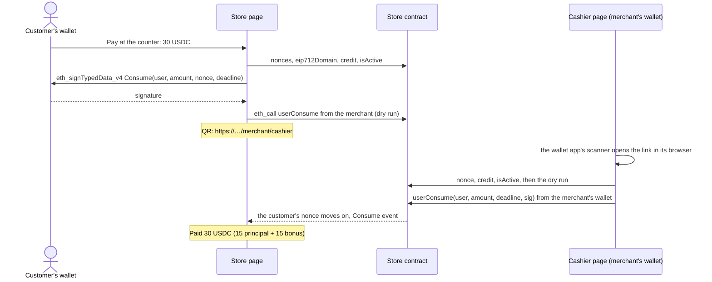

# Pay codes

Customers spend their credit at the counter the way Alipay and WeChat Pay users show a payment
code: the customer signs a payment in their wallet and shows it as a QR code, and the merchant scans
it and submits it on chain. No server stands in between, and the store contract is the only judge of
whether a code is good.

## Flow



Signing costs the customer no gas. The merchant's wallet sends the transaction and pays for it,
because `userConsume` is `onlyMerchant`.

## What the customer signs

```json
{
  "domain": {
    "name": "NeverRunaway Store",
    "version": "1",
    "chainId": 1952,
    "verifyingContract": "<store contract>"
  },
  "primaryType": "Consume",
  "types": {
    "Consume": [
      { "name": "user", "type": "address" },
      { "name": "amount", "type": "uint256" },
      { "name": "nonce", "type": "uint256" },
      { "name": "deadline", "type": "uint256" }
    ]
  },
  "message": { "user": "<customer>", "amount": "30000000", "nonce": "0", "deadline": "1792582400" }
}
```

- **The domain comes from the store**, through [ERC-5267](https://eips.ethereum.org/EIPS/eip-5267)
  `eip712Domain()`, so the app signs for exactly the domain the contract checks. Only the fields
  its bitmap marks as used go in: viem's `getEip712Domain` also returns a salt, and OpenZeppelin's
  unused zero salt would enter the domain type and change the domain separator. With the salt left
  in, every signature fails; `packages/shared/src/payCode.test.ts` and the anvil suite pin this.
- **`chainId` and `verifyingContract`** bind a code to one store on one chain.
- **`amount` is in base units.** EIP-712 has no notion of decimals, so wallets show `30000000` for
  30 USDC. The pay dialog says so next to the amount.
- **`nonce`** is the customer's [OpenZeppelin `Nonces`](https://docs.openzeppelin.com/contracts/5.x/api/utils#Nonces)
  counter at this store. Each nonce can be charged once, in order.
- **`deadline`** is five minutes out, measured from the later of the device clock and the latest
  block, so a phone whose clock runs slow can't sign a code the chain already sees as expired.
  Countdowns apply the same correction.

`packages/shared/src/payCode.ts` holds the types; its test checks that they hash exactly like the
contract's `_hashTypedDataV4(keccak256(abi.encode(CONSUME_TYPEHASH, ...)))`.

## The link

`https://<app>/merchant/cashier#v=1&chain=1952&store=0x…&user=0x…&amount=30000000&nonce=0&deadline=1792582400&sig=0x…`

| Parameter  | Meaning                                                                          |
| ---------- | -------------------------------------------------------------------------------- |
| `v`        | Format version, `1`                                                              |
| `chain`    | Chain ID                                                                         |
| `store`    | Store contract                                                                   |
| `user`     | The customer. ECDSA could recover it, but an ERC-1271 account's address can't be |
| `amount`   | Base units of the store's token                                                  |
| `nonce`    | The nonce signed, which tells the cashier "already charged" apart from "invalid" |
| `deadline` | Unix seconds                                                                     |
| `sig`      | The signature: 65 bytes from an EOA, any length from an ERC-1271 smart account   |

- **A plain https link.** A wallet app's own scanner opens it in the wallet's dApp browser, where
  the merchant's wallet is already connected, and a phone camera opens it in a browser. Wallet
  in-app browsers don't always give pages camera access, so nothing depends on scanning inside the
  page.
- **The code sits in the fragment.** Browsers never send the fragment to a server, so no server or
  CDN log keeps signatures, addresses or amounts.
- **Readable key=value pairs** rather than base64: a code can be read and debugged by eye. A link is
  about 340 to 370 characters, a version 14 or 15 QR code at error correction M (73 to 77 modules),
  which scans easily from a phone screen.
- **Strict decoding** (zod): one malformed field rejects the whole code. Unknown parameters are
  ignored, so a later version can add optional ones. A link that was percent-encoded on its way
  through a deep link or a chat app is decoded once.
- The cashier page also takes a link pasted from a chat or typed by a USB barcode scanner, which
  ends it with Enter.

## Who checks what

1. **The customer's page, before the code is shown.** The store is open and the credit covers the
   amount. After signing, an EOA's v = 0 or 1 is rewritten as 27 or 28, an
   [ERC-6492](https://eips.ethereum.org/EIPS/eip-6492) signature (a smart account that isn't
   deployed yet) is refused with an explanation, and `userConsume` runs as an `eth_call` from the
   store's merchant. A wallet whose signature the contract won't accept is caught here rather than
   at the counter.
2. **The cashier page.** The code is for this app's chain and for a store the factory created
   (anyone can deploy a look-alike contract and craft a link to it). Then the nonce (charged
   already?), the deadline, the store and the credit, and the same dry run for the signature,
   repeated every four seconds. Charge is only offered to the store's merchant wallet, and the call
   is simulated once more right before the wallet opens.
3. **The contract** checks everything again and has the final say: `onlyMerchant`, the deadline,
   the store, the credit, the nonce, and `SignatureChecker` (ECDSA for accounts without code,
   ERC-1271 for contract accounts).

The frontend never verifies the signature on its own. viem's `verifyTypedData` also accepts
ERC-6492 and ERC-8010 signatures, which the contract's `SignatureChecker` doesn't, so a local check
could approve a code the contract then rejects. The dry run asks the contract itself.

## One live code per store

Codes are signed with the customer's current nonce, so every code made before the next charge
shares it, and charging one voids the others. Making a new code for a different amount is therefore
safe: at most one of them can be charged.

The customer's screen polls `nonces(customer)` every two seconds. Once it moves past the code's
nonce, the screen looks up the `Consume` event with that nonce and shows the amount actually
charged (which may be another code's) with its principal and bonus parts.

## Limits

- **A code is a bearer authorization for one charge.** Whoever presents it to the store can have it
  charged once, for the signed amount, until the deadline. Like an Alipay payment code, it should
  only be shown to the cashier, and the screen says so.
- **Nothing cancels a signed code.** The contract has no way for a customer to burn a nonce, so
  closing the window doesn't revoke a code; the screen says until when it stays valid. The
  five-minute deadline bounds this. A later contract version could add an `invalidateNonce()`.
- **The amount is fixed when signing.** The merchant can't charge more or less; a wrong amount
  needs a new code.
- **Only the merchant's own wallet can charge**, and it pays the gas. Separate cashier wallets for
  staff would need a contract change.
- **Smart accounts** work through ERC-1271 once deployed.

## Wallet notes

- Signing uses `eth_signTypedData_v4`. MetaMask refuses typed data whose `chainId` differs from the
  network it is on, so Pay at the counter is disabled on the wrong network and the banner offers to
  switch.
- Some wallets, hardware wallets especially, return v = 0 or 1, which OpenZeppelin's ECDSA rejects.
  Only an EOA's signature is rewritten: a smart account can give those values a meaning of its own
  (Safe uses v = 0 and 1 for contract and approved-hash signatures).
- The code screen keeps the display on through the
  [Screen Wake Lock API](https://developer.mozilla.org/docs/Web/API/Screen_Wake_Lock_API) where
  the browser has it.

## To verify on devices

- Each wallet's scanner keeps the URL fragment when it opens the link in its browser (OKX, Bitget,
  MetaMask, TokenPocket, imToken, Trust).
- MetaMask's `link.metamask.io/dapp/<url>` format keeps a fragment when the cashier is opened in the
  app from another browser.
- How each wallet presents the Consume request: the domain name, the store contract and the raw
  amount.
- The Screen Wake Lock API in wallet in-app browsers.
